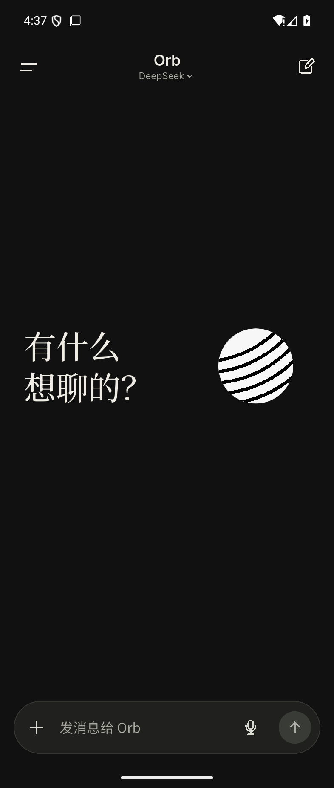
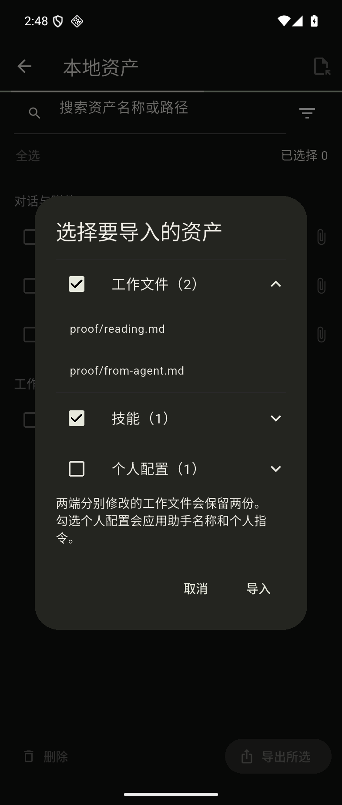

# Orb Mobile

Orb 是一款 Android 和 iOS 聊天助手。你选模型，手机保存对话、记忆和工作文件。可以从一句「记住我喜欢短一点的书评」开始，下一次聊书时继续用这个偏好。想在电脑上接着写，也可以把选中的对话和笔记导出成 Markdown。

**[下载 Android 安装包（ARM64 APK）](https://github.com/vastaq/orb-mobile/releases/download/v0.3.0-build.9/Orb-Android-arm64.apk)** · [0.3.0 Build 9 版本说明与校验值](https://github.com/vastaq/orb-mobile/releases/tag/v0.3.0-build.9)

在手机浏览器登录有本仓库访问权限的 GitHub 账号，下载后打开 APK 安装。iOS 可从源码运行。

[接入模型](#接入模型) · [试试工作区](#试试工作区) · [从源码运行](#从源码运行)

<p>
  <a href="docs/images/chat-home.png"></a>
  <a href="docs/images/import-preview.png"></a>
</p>

*Android 模拟器实录。左图是新对话，右图是把工作文件带回手机时的导入预览。*

## 接入模型

1. 打开 Orb，点聊天页顶部的模型名称。默认是 DeepSeek，也可以选 OpenAI、Claude 或兼容 Chat Completions 的服务。
2. 填写所选服务的 API 密钥并保存。使用兼容服务时，填写服务地址和模型 ID。免鉴权服务可以留空密钥。
3. 回到聊天页发送第一条消息。加号可选附件，支持图片的模型还能接收照片。配置支持转写的语音服务后，麦克风会把文字填回草稿，方便你改完再发。使用 DeepSeek Flash 时，直接贴链接或问需要查证的问题，模型可按需读网页、做搜索。

对话和记忆存于手机。生成回答时，Orb 会把本轮输入、所选附件、近期对话和相关记忆发给你选的模型服务。模型调用按所选服务的规则计费，密钥由系统安全存储保管。你可以在「设置 → 本地记忆」查看、修改或删除记忆。

## 试试工作区

假设你想知道这个月在咖啡和交通上分别花了多少钱。选一个支持工具调用的模型（如 DeepSeek Flash），用下面两份示例账单试一次。

1. 把两份 CSV 保存到手机，在「设置 → 工作文件 → 导入文本文件」逐份选取并保存。[上半月.csv](docs/examples/上半月.csv) · [下半月.csv](docs/examples/下半月.csv)
2. 回到聊天页，发送这句话。

   > 读取工作区里的「上半月.csv」和「下半月.csv」，按类别合计花费，把分类金额和总额写入「月报.md」。

3. 回到「工作文件」打开 `月报.md`。示例中咖啡是 30 元，交通是 9 元，合计 39 元。想看 Orb 如何得出结果，可以展开回复里的「工具执行」。

如果下个月也要做同样的事，可以让 Orb 把算法保存为 JavaScript 程序，下次换一份输入再跑。工作区也支持在手机上编译和运行多文件 C 程序。[工作区的执行范围与限制](docs/architecture.md)

## 其他常用操作

| 想做什么 | 怎么用 |
| --- | --- |
| 一周后接着聊 | 用侧栏查找对话，或请 Orb 记住一项偏好。回复菜单可以查看本轮引用的记忆条数和 token 用量。 |
| 到点提醒或安排日程 | 说「每周五晚上八点提醒我整理书摘」，随后可以说「改到九点」。提醒在「设置 → 定时任务」管理。也可以请 Orb 查看系统日历，写入单次日程前会列出改动供确认。 |
| 在别的 App 里说句话 | Android 在「设置 → 应用外悬浮球」开启并授权。离开 Orb 后长按球说话，松手发送，再按可打断朗读。iPhone 可用聊天输入框的麦克风。 |
| 把文件带到电脑 | 在「设置 → 本地资产」勾选对话、记忆、附件或工作文件并导出 ZIP。解压后打开 `INDEX.md`，可直接阅读和编辑，再导回手机。[资产包格式](docs/portable-assets.md) |
| 给 Orb 加一种用法 | 在「设置 → 技能」导入一份 `SKILL.md`，或在「MCP 工具连接」选择允许模型调用的远端工具。前台写入需逐次确认，后台仅能调用已授权的只读 MCP 工具。[技能示例](docs/skills.md) · [MCP 配置](docs/mcp.md) |

## 从源码运行

准备 Flutter 3.47 或更高的兼容版本。Android 工程需要 SDK Platform 37 和支持 Java 17 的 JDK。iOS 需要 macOS 和 Xcode。连接手机或启动对应的模拟器。[Flutter 安装指南](https://docs.flutter.dev/install)

```sh
git clone https://github.com/vastaq/orb-mobile.git
cd orb-mobile
flutter pub get
flutter run
```

以下命令会构建 Android arm64 本地安装包。

```sh
flutter build apk --release --target-platform android-arm64
```

产物在 `build/app/outputs/flutter-apk/app-release.apk`，当前构建使用开发签名。开发检查可运行 `flutter analyze` 和 `flutter test`。集成用例的模型服务配置、模拟器与真机覆盖范围见[验证记录](docs/evaluation.md)。

## 项目文档

Orb 最初是为游戏构想的助手，手机版可以独立使用。

- [架构与游戏的关系](docs/architecture.md) — 一次回复如何组合上下文、调用手机工具并写回本地。
- [个人助手实测](docs/personal-assistant-benchmark.md) — 跨会话记忆、系统日历、外部笔记和后台提醒的实际结果。
- [工作区编辑实测](docs/workspace-harness-benchmark.md) — 如何验证模型找对文件、改对位置，并运行程序核对结果。
